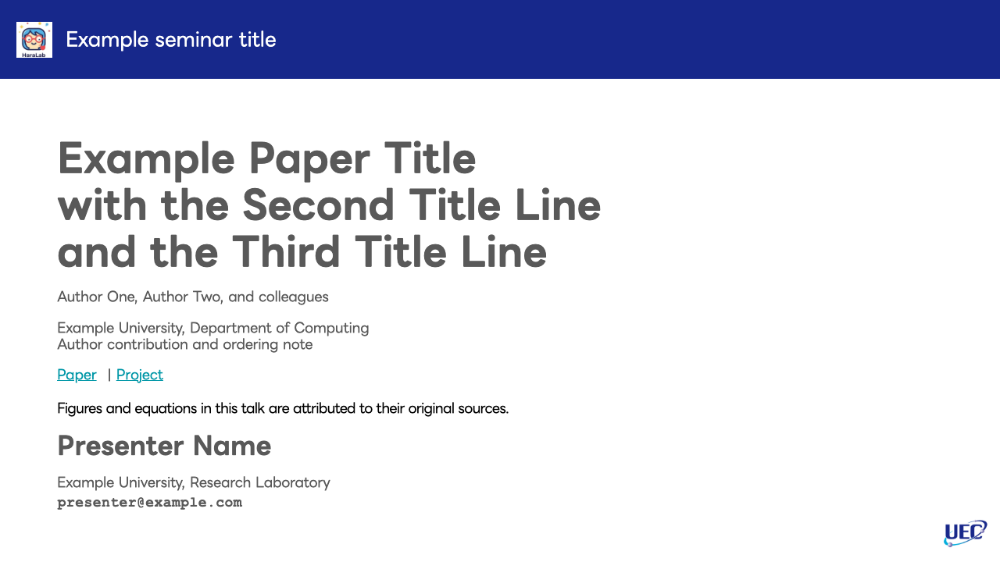
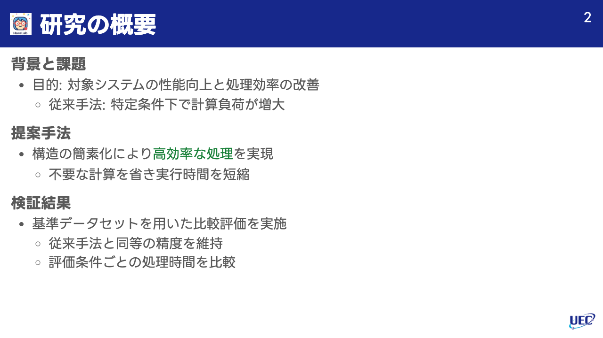

# slides

Marp で論文紹介や技術発表のスライドを書くリポジトリです。

## セットアップ

[mise](https://mise.jdx.dev/getting-started.html) と Google Chrome を用意し、リポジトリのルートで実行します。

```sh
mise trust
mise install
```

## プレビュー

`mise run preview`

ブラウザで <http://localhost:8080/slides/example/slides.md> を開きます。Markdown を保存すると表示が更新され、`Ctrl+C` でサーバーを終了します。

## PDF 出力

`mise run pdf`

`slides/` 内の全資料を変換し、`dist/<発表名>/slides.pdf` に出力します。

## テーマの見本

### ly

| 表紙                                                        | 本文                                                       |
| ----------------------------------------------------------- | ---------------------------------------------------------- |
|  |  |

### uec-haralab

| 表紙                                                                          | 本文                                                                         |
| ----------------------------------------------------------------------------- | ---------------------------------------------------------------------------- |
|  |  |

## ドキュメント

- [執筆ガイド](docs/authoring.md)
- [テーマガイド](docs/theme.md)
- [レイアウト検査](docs/check-layout.md)
- [CI](docs/ci.md)

Codex / Claude Code の執筆ルールは [AGENTS.md](AGENTS.md) にあります。
