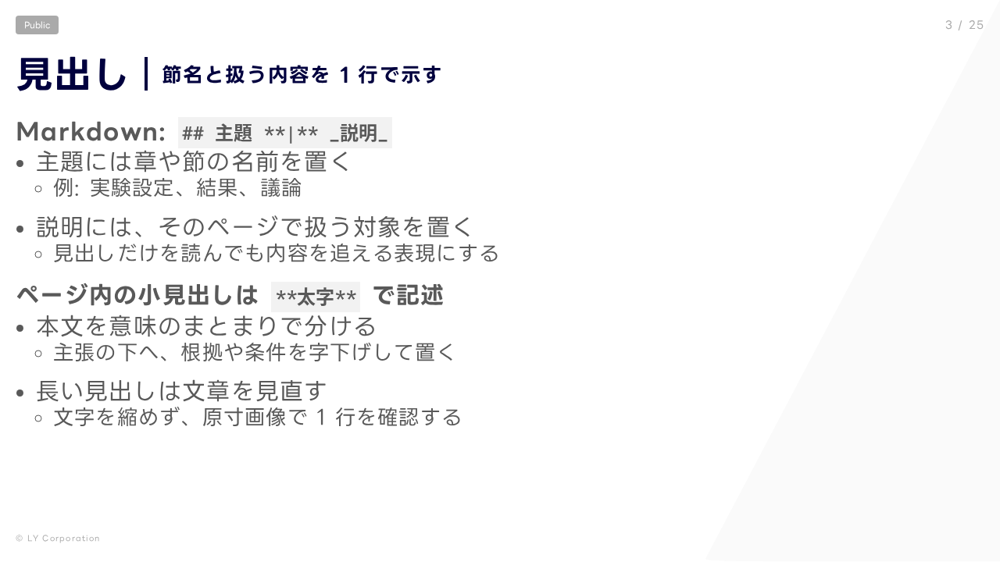

# slides

Marp で論文紹介や技術発表のスライドを書くリポジトリです。Markdown・テーマ CSS・画像を管理し、PDF は手元で生成します。執筆には Codex / Claude Code も使えます。

## セットアップ

[mise](https://mise.jdx.dev/getting-started.html) と Google Chrome を用意し、リポジトリのルートで実行します。

```sh
mise trust
mise install
```

## プレビュー

`mise run preview`

ブラウザで <http://localhost:8080/slides/example/slides.md> を開きます。Markdown を保存すると表示が更新され、`Ctrl+C` でサーバーを終了します。

## PDF 出力

`mise run pdf`

`slides/` 内の全資料を変換し、`dist/<発表名>/slides.pdf` に出力します。

## テーマの見本

各テーマのサンプルスライドから、表紙と本文の例を掲載しています。テーマや対象のサンプルスライドを変更した場合は `mise run readme-images` で見本画像を更新してください。CI の `check-readme-images` で画像の更新漏れを検出します。

### ly

| 表紙                                                        | 本文                                                       |
| ----------------------------------------------------------- | ---------------------------------------------------------- |
|  |  |

### uec-haralab

| 表紙                                                                          | 本文                                                                         |
| ----------------------------------------------------------------------------- | ---------------------------------------------------------------------------- |
|  |  |

## ドキュメント

- [執筆ガイド](docs/authoring.md): 資料の追加、見出し・引用・情報分類、表紙・自己紹介、VS Code のプレビュー
- [テーマガイド](docs/theme.md): テーマごとのレイアウトとクラス、見た目の調整、テーマの追加
- [レイアウト検査](docs/check-layout.md): 実行方法、出力ファイル、検査条件・閾値・限界
- [CI](docs/ci.md): ワークフロー、公開前検査、必須チェックの設定

Codex / Claude Code の執筆ルールは [AGENTS.md](AGENTS.md) にあります。`CLAUDE.md` は同じファイルへのシンボリックリンクです。
