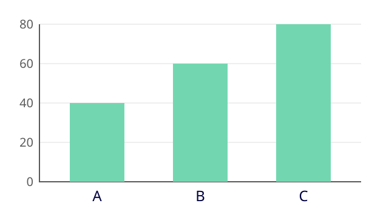
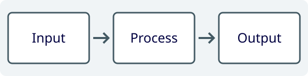
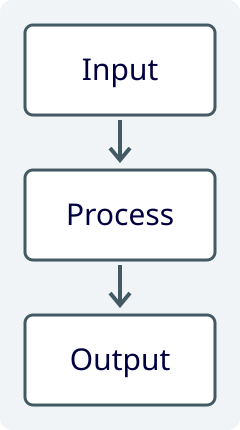

_発表タイトルの作例:\
ly テーマで作る\
技術スライド_
===

_著者名 A¹, 著者名 B²_

_¹ 所属 A / ² 所属 B_

_資料リンク: [example.org](https://example.org)_

> _**発表者の所属**_
>
> _**発表者の氏名**_
>
> _[プロフィールへのリンク](https://example.org)_

> _paper-title の配置見本。\
> タイトル・著者・所属・リンクを\
> 自分の発表内容へ差し替えます。_

---

<!-- _class: profile-slide content-slide-gray classification-public -->

## 自己紹介の配置 _氏名の表示例_

> **左列: 経歴と関心分野**
>
> - 所属・役割を最初に記載
>   - 聞き手と関わる仕事を一つ紹介
> - 経歴は年と出来事を対応付ける
>   - 例: ’26/04 新しい研究チームへ参加
>
> **右列: 写真と関連リンク**
>
> - 先頭の段落に写真を 2 枚配置
>   - 写真は北田俊輔の提供素材を使用
> - 次の段落にプロフィールリンクを配置
>   - 本文と写真を別の引用ブロックに分ける
>
> `profile-slide content-slide-gray`

>  
>
> [shunk031.me](https://shunk031.me) [@shunk031](https://x.com/shunk031)

---

<!-- _class: content-slide-gray classification-public -->

## 見出し **|** _節名と扱う内容を 1 行で示す_

**Markdown: `## 主題 **|** _説明_`**

- 主題には章や節の名前を置く
  - 例: 実験設定、結果、議論
- 説明には、そのページで扱う対象を置く
  - 見出しだけを読んでも内容を追える表現にする

**ページ内の小見出しは `**太字**` で記述**

- 本文を意味のまとまりで分ける
  - 主張の下へ、根拠や条件を字下げして置く
- 長い見出しは文章を見直す
  - 文字を縮めず、原寸画像で 1 行を確認する

---

<!-- _class: content-slide-gray classification-public -->

## 箇条書き **|** _主張・根拠・具体例の階層を保つ_

**通常の本文と入れ子の使用例**

- 親項目: このページで伝えたい主張
  - 子項目: 主張を支える根拠や条件
  - 子項目: 対象をイメージできる具体例
- 研究の紹介には、対応する原論文への引用を添える
  - 例: 自動翻訳の評価を扱う研究 _[[Papineni+ ACL’02](https://aclanthology.org/P02-1040/)]_
  - 著者・会議・年は、リンク先の原典と照合する
  - 表示用の角括弧はリンクの外に置く
- 強調する語は、その文の核となる部分に絞る
  - 例: 比較条件と評価対象を **同じ条件** にそろえる
  - 親項目と具体例を別の行に置き、関係を明示する

---

<!-- _class: analysis-slide efficiency-slide content-slide-gray classification-public -->

## 図とキャプション **|** _図の直下に説明を置く_

> 
>
> Figure from [[作例](assets/layout-chart.svg)]: 架空の条件別スコア\
> 横軸: 比較条件 A・B・C／縦軸: スコア

> **図と説明を一つの引用ブロックに置く**
>
> - 画像は同じ資料の `assets/` に保存
> - 代替テキストには図番号と内容を記載
> - キャプションは図の中央にそろえる
> - 軸の説明もキャプション内へ置く
> - この図は配置確認用の架空データ
>   - A: 40／B: 60／C: 80

**➜ 図・説明・軸の対応を原寸画像で確認する**

---

<!-- _class: results-slide content-slide-gray classification-public -->

## 表 **|** _同じ役割の情報を列にそろえる_

**Markdown の表で配置する要素**

| 要素     | 書き方       | 確認すること           |
| :------- | :----------- | :--------------------- |
| 見出し   | 先頭行       | 各列で何を比べるか     |
| 左寄せ   | `:---`       | 項目名を読み始める位置 |
| 右寄せ   | `---:`       | 数値の桁と単位         |
| 中央寄せ | `:---:`      | 短い分類ラベル         |
| 強調     | `**文字**`   | 注目する行や値         |
| 単位     | 見出しへ記載 | 数値の解釈             |
| 注記     | 表の直下     | 比較条件と対象範囲     |

- 表の見出しは 1 行で示す
- 数値比較では、条件や単位を省かない
- 原寸画像で列幅と改行を確認する

---

<!-- _class: comparison-slide content-slide-gray classification-public -->

## 左右の比較 **|** _同じ観点を同じ順番で並べる_

> **左列: 文章を中心に説明**
>
> - 対象: 背景や条件を言葉で示す内容
> - 構成: 見出し → 主張 → 根拠
> - 例: 手順の前提となる条件
> - 確認: 文節の切れ目と改行位置
> - 配置: 左右の先頭行をそろえる
> - 記述: 一つ目の引用ブロックを使用

> **右列: 図表を中心に説明**
>
> - 対象: 対応や数量を視覚化する内容
> - 構成: 見出し → 図表 → 説明
> - 例: 二つの条件で得られた結果
> - 確認: 図の読みやすさと単位
> - 配置: 左右の先頭行をそろえる
> - 記述: 二つ目の引用ブロックを使用

> **➜ `comparison-slide` で同じ観点を対応付ける**

---

<!-- _class: content-slide-gray classification-public -->

## 数式の注釈 **|** _記号の意味を式の近くに示す_

**例: 2 条件のスコアの平均を計算**

- $x$: 条件 A で得られたスコア
- $y$: 条件 B で得られたスコア
- $m$: 二つのスコアの平均

$$
\underbrace{m\vphantom{y}}_{\mathclap{\text{平均}}}
=\bigl(\underbrace{x\vphantom{y}}_{\mathclap{\text{条件 A}}}\;+\;\underbrace{y}_{\mathclap{\text{条件 B}}}\bigr)/2
$$

**下括弧の注釈は `\mathclap` で包む**

- 説明に必要な記号だけに注釈を付ける
- 注釈どうしの重なりと、下端の余白を原寸で確認する

---

<!-- _class: content-slide-gray classification-public -->

## 結論行 **|** _根拠を示した後に要点をまとめる_

**資料の構造を確認**

- タイトルで、そのページの対象を示す
  - 見出しだけを順に読んでも話を追える構成にする
- 主張の下に根拠と具体例を置く
  - 字下げで、親項目との対応を示す

**描画結果を確認**

- 図・表・数式の説明を対象の近くへ置く
  - 図のキャプション、表の注記、数式の注釈を照合する
- 原寸画像で改行と余白を確認する

**➜ 使用例をコピーし、自分の発表内容へ差し替える**

---

<!-- _class: title-slide-big classification-public -->

# 表紙用の背景

`_class: title-slide-big classification-public`

背景だけを切り替える使用例

---

<!-- _class: takahashi classification-public -->

# 一枚で一つ伝える

`_class: takahashi classification-public`

---

<!-- _class: content-slide-gray classification-public layout-example -->

## 本文用の背景

`_class: content-slide-gray classification-public layout-example`

---

<!-- _class: background-slide content-slide-gray classification-public -->

## 背景の配置 **|** _説明と四つの図を対応付ける_

**使用クラス: `background-slide`**

- **導入:** 最初の項目で、比較に必要な前提を説明
  - 例: 比較条件によって、処理の対象や手順が変わる
- **四つの例:** 最後の親項目の下へ、図付きの例を配置

  - **条件 A:** 入力の種類を確認

    

  - **条件 B:** 処理の順番を確認

    

  - **条件 C:** 出力の形式を確認

    

  - **条件 D:** 比較する範囲を確認

    

Figure from [[作例](assets/layout-pipeline.svg)]: 四つの画像枠への配置例

---

<!-- _class: analysis-slide case-study-slide content-slide-gray classification-public -->

## 事例の配置 **|** _二つの図と説明を三列に置く_

> 
>
> Figure from [[作例](assets/layout-flow.svg)]: 手順 A

> 
>
> Figure from [[作例](assets/layout-flow.svg)]: 手順 B

> **図を読み比べる観点**
>
> - 左列: 比較する一つ目の事例
> - 中列: 比較する二つ目の事例
> - 右列: 二つの事例に共通する説明
> - 入力・処理・出力の順に比較
> - キャプションは各図の直下に配置
> - 原寸画像で図中の文字を確認
>
> 使用クラス: `case-study-slide`

---

<!-- _class: dataset-slide content-slide-gray classification-public -->

## データ紹介の配置 **|** _図・表と収集手順を分ける_

> 
>
> Figure from [[作例](assets/layout-chart.svg)]: 架空の条件別スコア

> **条件ごとのスコアを記載**
>
> | 区分 | スコア | 用途 |
> | :--- | -----: | :--- |
> | A    |     40 | 学習 |
> | B    |     60 | 検証 |
> | C    |     80 | 評価 |

> **収集・分割の説明**
>
> - 対象: 何を集めたデータか
>   - 例: 配置確認用の架空データ
> - 収集: 含める条件と除外する条件
>   - 例: 対象範囲と収集期間を明記
> - 分割: 学習・検証・評価の区別
>   - 同じ対象の重複を確認
> - 数値: 図と表で単位をそろえる
>
> 使用クラス: `dataset-slide`

---

<!-- _class: analysis-slide experiment-slide content-slide-gray classification-public -->

## 実験設定の配置 **|** _比較条件と評価方法を左右に置く_

> **比較条件**
>
> - 対象: 配置確認用の架空データ
> - 条件 A: 標準の手順で処理
> - 条件 B: 一つの処理だけを変更
> - 固定: 入力・出力形式を統一
> - 反復: 同じ条件で複数回実行

> **評価方法**
>
> - 評価指標: 出力が正解と一致する割合
> - 単位: 割合は百分率で表示
> - 集計: 条件ごとに平均を計算
> - 確認: 件数と対象範囲を明記
> - 注意: 作例の値は実験結果ではない

- 使用クラス: `experiment-slide` と `analysis-slide`
  - 左右の引用ブロックに同じ粒度で条件と評価方法を記載
  - 全幅の箇条書きには、両方に共通する条件を配置
- 比較前に、条件ごとの件数と出力形式を確認

---

<!-- _class: analysis-slide failure-analysis-slide content-slide-gray classification-public -->

## 課題分析の配置 **|** _図と読み方を上段にまとめる_

> 
>
> Figure from [[作例](assets/layout-chart.svg)]: 条件 A・B・C の比較\
> 横軸: 比較条件／縦軸: スコア\
> 値は配置確認用の架空データ

**観察:** 条件 A より条件 C の値が高い

図の大小と文章の説明を対応付け、軸と単位を図の隣に置く

**注意:** 図だけから因果関係は判断しない

対象範囲と比較条件を併記。使用クラス: `failure-analysis-slide`

---

<!-- _class: method-slide content-slide-gray classification-public -->

## 手法の配置 **|** _上段の図と下段の二列で手順を示す_

> 
>
> Figure from [[作例](assets/layout-pipeline.svg)]: 入力から出力までの三段階

> **入力と処理**
>
> - 入力: 対象と前提条件を示す
> - 処理: 実行順に手順を説明
> - 固定する条件を明記
> - 図の各段階と本文を対応付ける

> **出力と確認**
>
> - 出力: 得られる結果の形式を示す
> - 確認: 入力との対応を照合
> - 処理の目的と結果を区別
> - 使用クラス: `method-slide`

---

<!-- _class: method-slide mason-overview-slide content-slide-gray classification-public -->

## 全体図の配置 **|** _低い図の下へ二つの処理を並べる_

> 
>
> Figure from [[作例](assets/layout-pipeline.svg)]: 三段階の処理を示す模式図

> **処理 A の説明**
>
> - 入力: 最初に受け取るデータ
>   - 形式と必要な属性を説明
> - 処理: 入力の内容を確認
>   - 対象が条件を満たすか判定
> - 出力: 次の処理へ渡すデータ
>   - 形式と引き継ぐ情報を明記

> **処理 B の説明**
>
> - 入力: 処理 A から受け取るデータ
>   - 形式と必要な属性を説明
> - 処理: 目的に応じて変換
>   - 入力との対応を維持
> - 出力: 最終的に返すデータ
>   - 形式と利用する場面を明記

使用クラス: `mason-overview-slide` と `method-slide`

---

<!-- _class: method-slide ma-slide content-slide-gray classification-public -->

## 左図・右本文の配置 **|** _右列に手順をまとめる_

> 
>
> Figure from [[作例](assets/layout-chart.svg)]: 条件 A・B・C の比較

> **図の対象と処理を説明**
>
> - 入力: 比較する三つの条件
>   - A・B・C を同じ尺度で評価
> - 処理: 条件ごとの値を集計
>   - 例: 40・60・80 の三つの値
> - 出力: 条件間の大小を可視化
>   - 横軸は条件、縦軸はスコア
> - 確認: 図と説明の条件名を照合
>
> 使用クラス: `ma-slide` と `method-slide`

$$
m=(40+60+80)/3=60
$$

**➜ 図・手順・集計式を同じページで対応付ける**

---

<!-- _class: problem-slide content-slide-gray classification-public -->

## 問題設定の配置 **|** _入力と出力を図の下で対応付ける_

> 
>
> Figure from [[作例](assets/layout-pipeline.svg)]: 入力・処理・出力の対応

> **入力として与えるもの**
>
> - 対象: 処理するデータ
>   - 例: 比較条件ごとのスコア
> - 条件: 処理前に決める範囲
>   - 例: 集計対象と単位
> - 質問: 何を求めるか
>   - 例: 三つの値の平均

> **出力として求めるもの**
>
> - 結果: 質問への回答
>   - 例: 平均値は 60
> - 説明: 回答を得た手順
>   - 例: 三つの値を合計して 3 で割る
> - 確認: 入力と回答の対応
>   - 使用クラス: `problem-slide`

---

<!-- _class: analysis-slide efficiency-slide qualitative-slide content-slide-gray classification-public -->

## 定性比較の配置 **|** _二つの図の隣で結果を説明する_

> 
>
> Figure from [[作例](assets/layout-flow.svg)]: 手順 A

> 
>
> Figure from [[作例](assets/layout-flow.svg)]: 手順 B

> **手順 A**
>
> - 入力の形式を確認
> - 一つずつ順に処理
> - 出力を個別に照合
> - 結果を個別に記録

> **手順 B**
>
> - 入力をまとめて確認
> - 条件ごとに一括処理
> - 出力を条件別に照合
> - 結果を条件別に記録

- 使用クラス: `qualitative-slide` と `analysis-slide`・`efficiency-slide`
  - 図と本文は同じ順で入力・処理・出力を説明
  - キャプションは各図と説明の下にまとめて配置
- 原寸で、図中の文字と本文の改行を確認

---

<!-- _class: selection-slide content-slide-gray classification-public -->

## 導入の配置 **|** _問いと図を並べて着目点を下段に置く_

> 
>
> Figure from [[作例](assets/layout-pipeline.svg)]: 比較する処理の流れ

> **何を比べたいか**
>
> - 比較の目的を短く記載
> - 条件間の違いを具体化
> - 聞き手が持つ問いを示す
> - 図の処理名と本文を対応
> - 未説明の略語は避ける

> **後続の説明で確認すること**
>
> - 条件を変えると、どの値が変わるのか
> - 値の違いを説明するために、何を調べるのか
> - 使用クラス: `selection-slide`

---

<!-- _class: method-slide sp-slide content-slide-gray classification-public -->

## 右表・右数式の配置 **|** _左図と属性表を対応付ける_

> 
>
> Figure from [[作例](assets/layout-chart.svg)]: 架空の三条件\
> 横軸: 比較条件／縦軸: スコア

> **条件を属性として整理**
>
> - 対象: 条件 A・B・C のスコア
> - 入力: 条件名と値の組
> - 処理: 三つの値から平均を計算
>
> | 属性 | 内容       |
> | :--- | :--------- |
> | 条件 | A・B・C    |
> | 値   | 40・60・80 |
> | 単位 | スコア     |
> | 平均 | 60         |
>
> 使用クラス: `sp-slide` と `method-slide`

$$
m=(40+60+80)/3=60
$$

---

<!-- _class: analysis-slide efficiency-slide summary-slide content-slide-gray classification-public -->

## まとめの配置 **|** _左の図と右の要点を上端でそろえる_

> 
>
> Figure from [[作例](assets/layout-chart.svg)]: 架空の条件別スコア\
> 横軸: 比較条件／縦軸: スコア

> **伝えたい内容を再確認**
>
> - 対象: 最初に立てた問いを示す
>   - 例: どの条件で値が高くなるか
> - 結果: 根拠となる図と対応付ける
>   - 例: C の値は 80
> - 範囲: 結果を適用できる条件を示す
>   - 作例の値は架空データ
> - 次の行動: 読者が確認する点を示す
>   - 原寸で図と本文の上端を確認

使用クラス: `summary-slide` と `analysis-slide`・`efficiency-slide`
