_Beyond Atomic Layouts:\
Compositional Design Understanding\
with Vision‑Language Models_
===

_Yiyang Huang¹˒²\*, Zhaowen Wang²†, Simon Jenni², Jing Shi²,
Yitian Zhang¹, Yizhou Wang¹, and Yun Fu¹_

_¹Northeastern University, Boston, USA / ²Adobe Research, San Jose, USA_

_Project page: [hukcc.github.io/Beyond-Atomic-Layouts/](https://hukcc.github.io/Beyond-Atomic-Layouts/), arXiv: [arxiv.org/abs/2608.26716](https://arxiv.org/abs/2608.26716)_

> _**AI CBU / Visual Generation Dept.**_
>
> _**Shunsuke Kitada, Ph.D.**_
>
> _[shunk031.me](https://shunk031.me) / [@shunk031](https://x.com/shunk031)_

> _※本発表で紹介する図や数式は
> 対象の論文から引用しております_

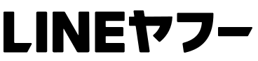

---

<!-- _class: profile-slide content-slide-gray classification-public -->

## 自己紹介: 北田俊輔 _Shunsuke KITADA_

> **経歴**
>
> - ’23/04 LINE → ’23/10 LINE ヤフー Research Scientist
> - ’23/03 法政大学大学院 彌冨研 博士（工学）/ 学振 DC2
>
> **研究分野**
>
> - 自然言語処理（NLP）/ 画像処理（CV）
>   - 摂動に頑健で解釈可能な深層学習 _[[Kitada+ IEEE Access’21](https://shunk031.me/publication/kitada2021making/), [Appl. Intell.’22](https://shunk031.me/publication/kitada2022making/)]_
> - 計算機広告（Multi-modal / Vision & Language）
>   - 効果の高いデジタル広告の作成支援 _[[Kitada+ KDD’19](https://shunk031.me/publication/kitada2019conversion/)]_
>   - 効果の低いデジタル広告の停止支援 _[[Kitada+ Appl. Sci.’22](https://shunk031.me/publication/kitada2022ad/)]_
> - **デザイン生成 AI**
>   - 離散拡散モデルで生成されたレイアウトの再調整 _[[Iwai+ ECCV’24](https://shunk031.me/publication/iwai2024layout/)]_
>   - LLM によるレイアウトの生成における自己修正 _[[Zhang+ arXiv’24](https://shunk031.me/publication/zhang2024vascar/)]_
>   - 田植えをするように潜在表現を植える画像生成 _[[Nagai+ CVPR-F’26](https://shunk031.me/publication/nagai2026taue/)]_

>  
>
> [shunk031.me](https://shunk031.me) [@shunk031](https://x.com/shunk031)
>
>  [画像生成 AI における拡散モデルの理論と実践](https://bit.ly/KitadaXColosoJP1)
>
> [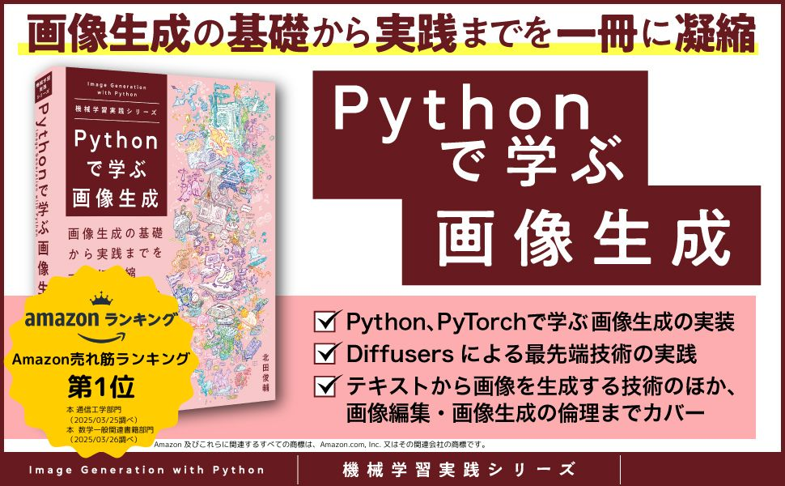](https://book.impress.co.jp/books/1123101104) [Python で学ぶ画像生成](https://book.impress.co.jp/books/1123101104)

---

<!-- _class: selection-slide content-slide-gray classification-public -->
<!-- 発表目安 0:45 -->

## 本論文の選定理由 **|** _デザイン編集に向けたレイヤー間の関係へ注目_

> 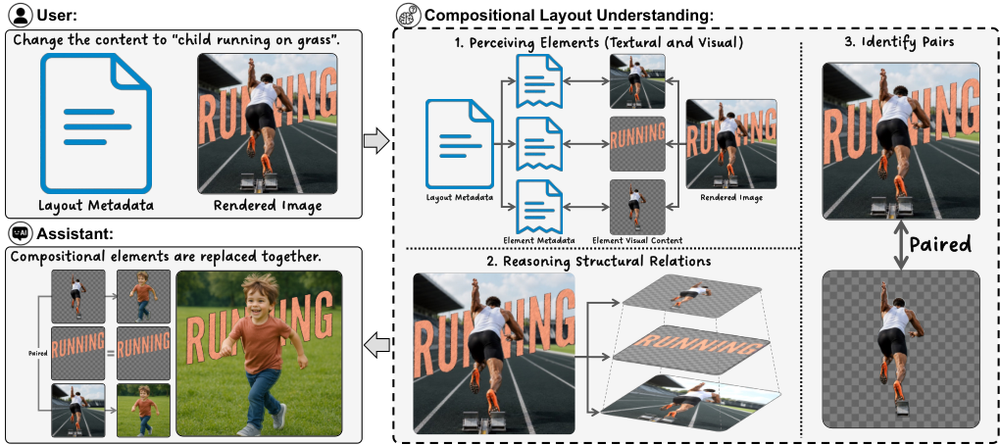
>
> Figure from [[Huang+ ECCV’26](https://arxiv.org/html/2608.26716v1#S0.F1.sf5)]: デザイン支援の例

> **デザインを「作る」だけでなく\
> 「意図どおりに直す」ことが難しい**
>
> - 複数のレイヤーで 1 つの視覚効果を表現
>   - 文字を人物の背後に差し込む
>   - 文字の一部を図形へ置き換える
> - 1 つの見た目を編集するには、\
>   関連するレイヤーをまとめて特定
> - 完成画像だけでは、どのレイヤーを編集するか分かりにくい

> **本論文で注目したい点**
>
> - 完成画像だけでなく、編集可能なレイヤー情報まで使って関連要素を特定できるか
> - 単純に近い／重なる要素ではなく、デザイン上の意図で結びついた要素を推定できるか
> - その能力を何の教師信号で学習させるのか

---

<!-- _class: background-slide content-slide-gray classification-public -->
<!-- 発表目安 0:50 -->

## 背景 **|** _Atomic layout と compositional layout の違い_

- **Atomic layout:** 文書や画面を、文字・画像・ボタンなどの独立した要素として扱う
  - 位置・種類・読み順を手掛かりに、個別要素や画面の内容を理解
- **Compositional layout:** 複数のレイヤーが組み合わさり、1 つの視覚効果を構成

  - **(a) Clipping:**\
    切り抜いた画像と元画像の間に別要素を挿入

    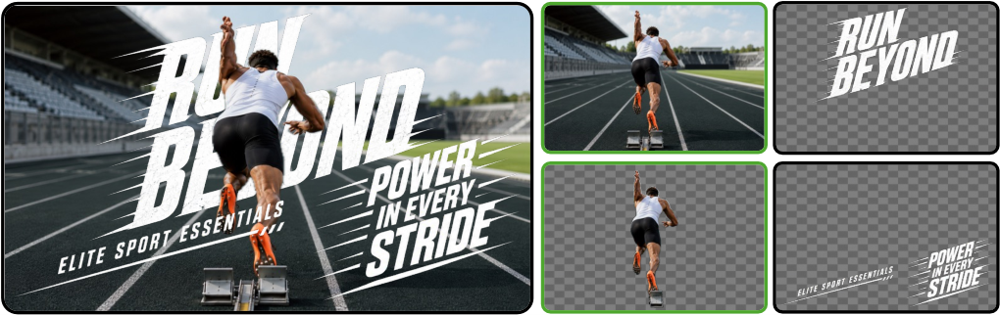

  - **(b) Blending:**\
    同じ画像の異なる領域を組み合わせて形状を表現

    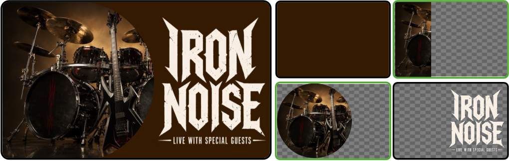

  - **(c) Overlaying:**\
    輪郭や影を重ねて視覚的な階層を強調

    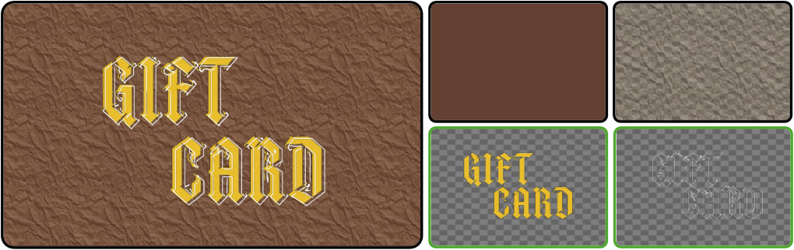

  - **(d) Morphing:**\
    文字の一部を画像・図形に置き換え

    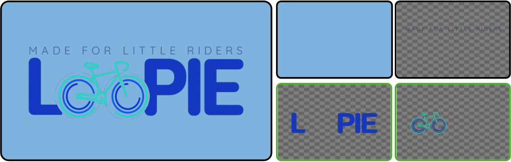

Figure from [[Huang+ ECCV’26](https://arxiv.org/html/2608.26716v1#S0.F1)]: Compositional layout の代表的な合成表現

---

<!-- _class: content-slide-gray classification-public -->
<!-- 発表目安 0:55。代表研究のみ口頭説明、全研究名を読み上げない -->

## 関連研究 **|** _個別要素の理解・レイヤー生成だけでは、合成関係を説明できない_

- **レイアウトの理解: 個別要素の位置・意味を認識**
  - LayoutLMv3 _[[Huang+ MM’22](https://arxiv.org/abs/2204.08387)]_: 文書の文字・画像・位置を統合
  - ScreenQA _[[Hsiao+ NAACL’25](https://arxiv.org/abs/2209.08199)]_ / CogAgent _[[Hong+ CVPR’24](https://openaccess.thecvf.com/content/CVPR2024/html/Hong_CogAgent_A_Visual_Language_Model_for_GUI_Agents_CVPR_2024_paper.html)]_:\
    画面の質問応答や操作対象の認識
  - InfographicVQA _[[Mathew+ WACV’22](https://openaccess.thecvf.com/content/WACV2022/html/Mathew_InfographicVQA_WACV_2022_paper.html)]_: 図表と文字を組み合わせた意味理解を評価
- **デザインの生成: 要素の配置・編集可能なレイヤーを出力**
  - LayoutDM _[[Inoue+ CVPR’23](https://openaccess.thecvf.com/content/CVPR2023/html/Inoue_LayoutDM_Discrete_Diffusion_Model_for_Controllable_Layout_Generation_CVPR_2023_paper.html)]_: 要素の位置・種類を生成
  - COLE _[[Jia+ arXiv’23](https://arxiv.org/abs/2311.16974)]_ / ART _[[Pu+ CVPR’25](https://openaccess.thecvf.com/content/CVPR2025/html/Pu_ART_Anonymous_Region_Transformer_for_Variable_Multi-Layer_Transparent_Image_Generation_CVPR_2025_paper.html)]_: 複数レイヤーからなるデザインを生成
- **本論文との差分**
  - PubLayNet _[[Zhong+ ICDAR’19](https://arxiv.org/abs/1908.07836)]_ / DocLayNet _[[Pfitzmann+ KDD’22](https://arxiv.org/abs/2206.01062)]_ は個別領域、\
    Crello _[[Yamaguchi ICCV’21](https://arxiv.org/abs/2108.01249)]_ / MLTD _[[Pu+ CVPR’25](https://openaccess.thecvf.com/content/CVPR2025/html/Pu_ART_Anonymous_Region_Transformer_for_Variable_Multi-Layer_Transparent_Image_Generation_CVPR_2025_paper.html)]_ はレイヤー構造を提供
    - 合成要素ペアとデザイン意図の明示的注釈はない _[[Huang+ ECCV’26](https://arxiv.org/html/2608.26716v1#S3.T1)]_

<!-- Table 1 は比較の典拠として参照。大きな表画像は1枚に併置しない -->

---

<!-- _class: content-slide-gray classification-public -->
<!-- 発表目安 0:55。3つの提案の役割を説明し、詳細は後続スライドで扱う -->

## 本論文の提案 **|** _合成レイアウト理解の課題・データセット・学習手法を提案_

**① 課題: Compositional Layout Understanding**

- 完成画像・レイヤー情報・指定要素から、合成関係にある要素とデザイン意図を予測
  - 個別要素の認識ではなく、要素間の関係を問う課題として定式化

**② データセット: CoDeLayout**

- 約2万件の実デザインから、関連する要素ペアとデザイン意図を質問応答形式で注釈
  - 複数レイヤーの編集構造を保持

**③ 学習手法: MASON**\
Multimodal Alignment and Structural perceptiON

- Multimodal Alignment（MA）: 完成画像と各レイヤーの対応付けを学習
- Structural Perception（SP）: レイヤー間の位置・重なり・前後関係を明示

**主な結果: 同一ベースモデル（Qwen2.5-VL 7B）**\
関連要素特定精度 88.80% → 91.66%（+2.86 pt） _[[Huang+ ECCV’26](https://arxiv.org/html/2608.26716v1#S5.T4)]_

---

<!-- _class: problem-slide content-slide-gray classification-public -->
<!-- 発表目安 1:00 -->

## 問題設定 **|** _指定レイヤーと合成関係にある要素を特定・意図を説明_

> 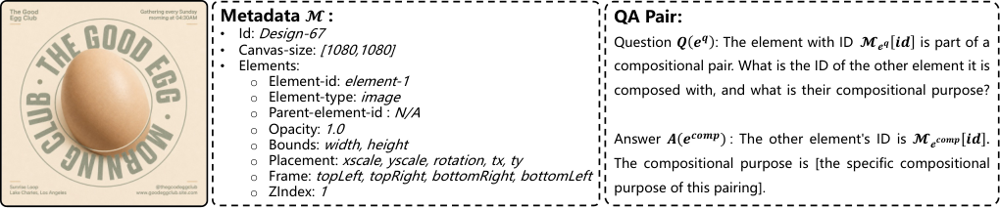
>
> Figure from [[Huang+ ECCV’26](https://arxiv.org/html/2608.26716v1#S3.F2)]: 画像・メタデータ・質問・回答の対応

> **入力: 完成画像 + 各レイヤーのメタデータ**
>
> $$
> \mathcal{L}=(\underbrace{\colorbox{#E2F0D9}{$\mathcal{I}$}}_{\mathclap{\text{完成画像}}},\quad\underbrace{\colorbox{#DBEAFE}{$\mathcal{M}$}}_{\mathclap{\text{メタデータ}}}),\,
> \mathcal{M}=\{\mathcal{M}_{e_1},\ldots,\mathcal{M}_{e_n}\}
> $$
>
> - $\mathcal{M}_{e_i}$: 要素識別子（ID）・種類・位置・\
>   不透明度・重なり順などの属性
> - 質問 $Q(e^q)$: 注目する要素 $e^q$ を指定

> **主タスク: 関連要素の特定と意図説明**
>
> - $e^{comp}$: 質問対象 $e^q$ と合成関係にある要素
>   - この要素の ID を回答
> - 2 つの要素が構成する視覚効果を自然言語で説明
> - 重なり・距離だけで合成関係は決まらない

---

<!-- _class: dataset-slide content-slide-gray classification-public -->
<!-- 発表目安 0:55 -->

## CoDeLayout **|** _約 2 万件の実デザインに関連要素ペアと意図を付与_

> 
>
> Figure from [[Huang+ ECCV’26](https://arxiv.org/html/2608.26716v1#S3.F2)]: デザインとメタデータ

> **実デザインを質問応答形式の教師データに変換**
>
> - 質問対象と正解要素のペアに意図を付与
> - 完成画像と各要素の JSON メタデータを保持
> - 編集可能な複数レイヤーの構造を保持

> **Train: 20,009 / Test: 387**
>
> - Test は全件人手確認
> - 平均 17.4 レイヤー\
>   99.8%が 45 レイヤー未満
>
> **4 種類の関係・Morphing も評価**
>
> | 関係         |     Train |       Test |
> | :----------- | --------: | ---------: |
> | Blending     |    56.78% |     40.06% |
> | Overlaying   |    22.83% |     29.95% |
> | Clipping     |    17.76% |     17.75% |
> | **Morphing** | **2.63%** | **12.24%** |

<!-- End of the table column; keep this note across both columns. -->

訓練は自然な偏りを維持 ／ テストは Morphing を増やして種類別評価

---

<!-- _class: analysis-slide failure-analysis-slide content-slide-gray classification-public -->
<!-- 発表目安 1:00 -->

## 課題分析 **|** _VLM の失敗要因は「要素の取り違え」と「階層関係の曖昧さ」_

Vision-Language Model（VLM）である GPT-4o の失敗要因を分析

> 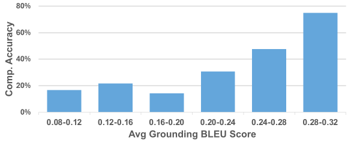
>
> Figure from [[Huang+ ECCV’26](https://arxiv.org/html/2608.26716v1#S3.F3.sf1)]: 要素対応付けと特定精度\
> 横軸: 説明文の語句一致度（平均 BLEU [[Papineni+ ACL’02](https://aclanthology.org/P02-1040/)]）\
> 縦軸: 関連要素の特定正解率（%）

> 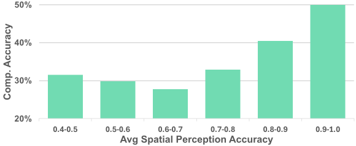
>
> Figure from [[Huang+ ECCV’26](https://arxiv.org/html/2608.26716v1#S3.F3.sf2)]: 空間関係認識と特定精度\
> 横軸: 空間関係の正答率\
> 縦軸: 関連要素の特定正解率（%）

> **Semantic drift:**\
> メタデータと画像中の見た目の不一致
>
> - 比較対象は要素画像と完成画像の説明
>   - 重なって隠れた指定要素を見失う

> **Structural ambiguity:**\
> レイヤー間の曖昧な関係
>
> - 1 デザイン 30 組の要素ペアで測定
>   - 位置だけでは前後・包含・重なりは不明

**➜ GPT-4o の分析で両精度が要素特定と連動 → 対応付け・構造理解を別々に改善**

---

<!-- _class: method-slide content-slide-gray classification-public -->
<!-- 発表目安 0:45 -->

## MASON 1/3 **|** _2 つの失敗要因へ別々の学習支援を追加_

> 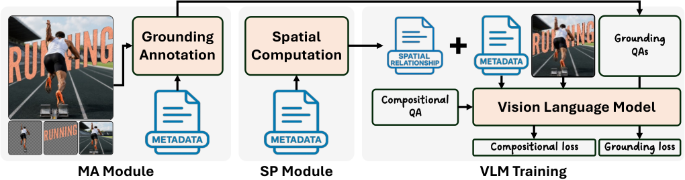
>
> Figure from [[Huang+ ECCV’26](https://arxiv.org/html/2608.26716v1#S3.F4)]: MA・SP を組み込む追加学習の全体像

> **Multimodal Alignment（MA）**
>
> - 対処する失敗要因: Semantic drift
> - 方針: ID と見た目の対応を質問応答に含める

> **Structural Perception（SP）**
>
> - 対処する失敗要因: Structural ambiguity
> - 方針: 質問対象との空間関係をメタデータに含める

Qwen2.5-VL 7B _[[Bai+ arXiv’25](https://arxiv.org/abs/2502.13923)]_ を追加学習：入力・教師データ拡張、モデル構造は不変

---

<!-- _class: method-slide ma-slide content-slide-gray classification-public -->
<!-- 発表目安 1:00 -->

## MASON 2/3 **|** _MA: 要素 ID と完成画像中の見た目を対応付けて学習_

> 
>
> Figure from [[Huang+ ECCV’26](https://arxiv.org/html/2608.26716v1#S3.F4)]:\
> 補助 QA の生成

> **Grounding QA（要素の対応付け問題）を生成**
>
> - 入力: 完成画像・対象要素の切り出し画像\
>   対象要素のメタデータ・質問
> - $Q^g(e_i)$: 要素 $e_i$ の見た目と位置を問う質問
>   - [Table 2（和訳）](https://arxiv.org/html/2608.26716v1#S4.T2): 「ID が $i$ の要素は何か。\
>     完成画像のどこにあるか」
> - 出力 $A^g(e_i)$: 要素の視覚的特徴と位置を記述した回答
>   - GPT-4o が生成し、MASON の学習に使用
> - 推論時には GPT-4o を使用しない

$$
\underbrace{A^g(e_i)}_{\mathclap{\text{学習用の回答}}} =
\underbrace{\mathcal{G}}_{\mathclap{\text{GPT-4o}}}\qquad\Bigl(
\underbrace{\mathcal{P}_{\mathrm{ground}}}_{\mathclap{\text{生成用プロンプト}}}\qquad\quad\Bigl(
\underbrace{\mathcal{L}}_{\mathclap{\text{画像＋メタデータ}}},\qquad\quad
\underbrace{\mathcal{I}_{e_i}}_{\mathclap{\text{切り出し画像}}},\qquad\quad
\underbrace{\mathcal{M}_{e_i}}_{\mathclap{\text{対象要素の属性}}},\qquad
\underbrace{Q^g(e_i)}_{\mathclap{\text{質問}}}
\Bigr)\Bigr)
$$

**➜ 完成画像と切り出し画像を対応付け、隠れた要素の視覚と言語の対応を強化**

---

<!-- _class: method-slide sp-slide content-slide-gray classification-public -->
<!-- 発表目安 1:00 -->

## MASON 3/3 **|** _SP: 質問対象レイヤーとの関係をメタデータへ明示_

> 
>
> Figure from [[Huang+ ECCV’26](https://arxiv.org/html/2608.26716v1#S3.F4)]:\
> レイヤー間の空間関係を計算

> **座標・重なり順だけでは要素間の関係が読みにくい**
>
> - 各候補 $e_i$ に、質問対象 $e^q$ との空間関係を追加
>   - メタデータの spatialRelationship フィールドに記述
>
> **[質問対象から見た候補の空間関係（Table 3）](https://arxiv.org/html/2608.26716v1#S4.T3)**
>
> | 関係       | 属性が表す内容     |
> | :--------- | :----------------- |
> | 重なり     | 有無・重複率       |
> | 包含       | 包含・被包含・なし |
> | 位置・距離 | 中心距離・上下左右 |
> | 前後       | どちらが前面か     |
>
> - **学習時・推論時の両方で拡張メタデータ $\mathcal{M}'$ を利用**

$$
\mathcal{M}'_{e_i}=\mathcal{M}_{e_i}\cup\texttt{spatialRelationship}(e_i,e^q)
$$

---

<!-- _class: analysis-slide experiment-slide content-slide-gray classification-public -->
<!-- 発表目安 0:50 -->
<!-- 論文: https://arxiv.org/html/2608.26716v1 Sec. 4.3, Sec. 5.1–5.2, Eq. 4 -->

## 実験設定 **|** _主タスクだけで微調整した DF と比べ、MA・SP の効果を評価_

$$
\underbrace{\hat A}_{\mathclap{\text{回答}}}
=\operatorname{VLM}\Bigl((\underbrace{\mathcal I}_{\mathclap{\text{完成画像}}},\qquad
\underbrace{\mathcal M'}_{\mathclap{\text{拡張メタデータ}}}),\qquad\qquad
\underbrace{Q}_{\mathclap{\text{2種類の質問}}}\Bigr)
$$

> **学習条件の比較**
>
> - 主タスク: 関連要素 ID と意図を回答
> - Direct Finetune（DF）: 主タスク QA のみで微調整
> - MASON: 主タスク＋ MA・SP

> **共通のモデル・実行条件**
>
> - Qwen2.5-VL 7B _[[Bai+ arXiv’25](https://arxiv.org/abs/2502.13923)]_
> - 低ランク適応（Low-Rank Adaptation; LoRA） _[[Hu+ ICLR’22](https://arxiv.org/abs/2106.09685)]_
>   - 3 エポック / 学習率 $3\times10^{-5}$
>   - ランク 4 / 8×A100
> - 画像 336×336 / 出力は最大 256 トークン

**指標**: Accuracy（ID 一致率）

- GPT-Score _[[Zheng+ NeurIPS’23](https://arxiv.org/abs/2306.05685)]_: 意図との意味的一致（0–10）
- BLEU _[[Papineni+ ACL’02](https://aclanthology.org/P02-1040/)]_・ROUGE _[[Lin+ ACL WS’04](https://aclanthology.org/W04-1013/)]_: 参照文との語句一致

---

<!-- _class: analysis-slide results-slide content-slide-gray classification-public -->
<!-- 発表目安 1:20 -->

## 結果 1/2 **|** _MASON は DF より +2.86 pt 改善_

**CoDeLayout: 関連要素の特定精度（%）**

| モデル        | 学習データ         | 重み付き精度 |  Clipping |  Morphing |
| :------------ | :----------------- | -----------: | --------: | --------: |
| Max-Overlap   | なし（規則ベース） |        44.27 |     69.70 |     36.17 |
| Qwen2.5-VL 7B | zero-shot          |        52.60 |     37.88 |     36.17 |
| Qwen3-VL      | zero-shot          |        77.08 |     71.21 |     55.32 |
| GPT-o3        | zero-shot          |        79.68 |     63.64 |     68.09 |
| DF            | 全データ           |        88.80 |     83.33 |     65.96 |
| **MASON**     | **全データ**       |    **91.66** | **90.91** | **70.21** |

_[[Huang+ ECCV’26](https://arxiv.org/html/2608.26716v1#S5.T4)]: Table 4 の主要列を再構成。重み付き精度はテストデータの構成比で重み付け_

- Clipping: DF 83.33 → MASON 90.91（+7.58 pt）/ Morphing は 70.21%に留まる
- GPT-o3 比: +11.98 pt（79.68 → 91.66）

---

<!-- _class: analysis-slide efficiency-slide content-slide-gray classification-public -->
<!-- 発表目安 0:50 -->

## 結果 2/2 **|** _MASON は主タスク 30% で、全データを使う DF より高精度_

> 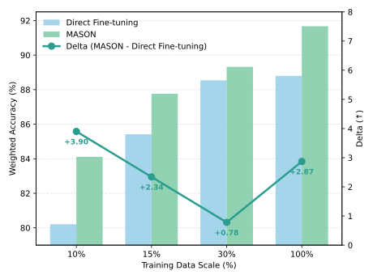
>
> Figure from [[Huang+ ECCV’26](https://arxiv.org/html/2608.26716v1#S5.F5.fig1)]: 訓練データ量と精度\
> 横軸: 主タスクの訓練データ割合\
> 左縦軸: 重み付き精度／右縦軸: MASON と DF の精度差

> **重み付き精度と種類別の平均精度（%）**
>
> | モデル    | 主タスクデータ |      精度 |      平均 |
> | :-------- | -------------: | --------: | --------: |
> | DF        |           100% |     88.80 |     84.30 |
> | **MASON** |        **30%** | **89.32** | **86.12** |
> | MASON     |           100% |     91.66 |     88.07 |
>
> _[[Huang+ ECCV’26](https://arxiv.org/html/2608.26716v1#S5.T4)]: Table 4 を再構成_
>
> **MA・SP で主タスクの必要データ量を削減**
>
> - MASON（主タスク 30%）
>   - 主タスク QA 約 6K ペア
>   - 補助 Grounding QA 約 2K ペア
> - DF（主タスク 100%）
>   - 主タスク QA 約 20K ペア

---

<!-- _class: analysis-slide results-slide content-slide-gray classification-public -->
<!-- 発表目安 1:10 -->

## Ablation 1/2 **|** _MA・SP の組み合わせ効果は単純な加算ではない_

**種類ごとの件数を均衡化した部分データで MA・SP を比較（精度 %）**

| モデル         | 重み付き精度 |  平均精度 |  Clipping |  Morphing |
| :------------- | -----------: | --------: | --------: | --------: |
| DF             |        80.21 |     78.36 |     74.24 |     72.34 |
| DF + MA        |        82.03 |     80.32 |     81.82 |     70.21 |
| DF + SP        |        83.85 |     82.51 | **83.33** |     74.47 |
| MASON（MA+SP） |    **84.11** | **83.40** |     81.82 | **80.85** |

_[[Huang+ ECCV’26](https://arxiv.org/html/2608.26716v1#S5.T5)]: Table 5 の主要列を再構成_

**MA・SP の学習効果（Table 4 の全データ結果とは別条件）**

- DF 比の重み付き精度: MA **+1.82 pt** / SP **+3.64 pt**
- MA+SP: **+3.90 pt**（SP 単独からの改善は +0.26 pt）
- Morphing: DF 72.34 → MA+SP **80.85**
- Clipping: SP 単独 **83.33** > MA+SP 81.82（組み合わせで低下）

---

<!-- _class: analysis-slide efficiency-slide content-slide-gray classification-public -->
<!-- 発表目安 0:55 -->

## Ablation 2/2 **|** _構造情報だけでは不十分・画像と要素対応の両方が重要_

> **画像入力の除去で両モデルの精度が低下**
>
> | モデル | 画像あり | 画像なし |
> | :----- | -------: | -------: |
> | DF     |     88.8 |     60.9 |
> | MASON  | **91.6** | **65.1** |
>
> _[[Huang+ ECCV’26](https://arxiv.org/html/2608.26716v1#S5.T7)]: Table 7 / 重み付き精度（%）_
>
> - MASON: **−26.5 pt**（91.6 → 65.1）
> - SP で重なり・包含・レイヤー順を付与しても、画像に依存する視覚的な意味関係は残る

> **Grounding QA の生成モデルを比較**
>
> | 生成モデル                 |     精度 |
> | :------------------------- | -------: |
> | GPT-4o                     | **91.6** |
> | Qwen3-VL（直接生成）       |     90.7 |
> | Qwen3-VL（スクリプト併用） |     91.1 |
>
> _[[Huang+ ECCV’26](https://arxiv.org/html/2608.26716v1#S5.T6)]: Table 6 / 重み付き精度（%）_
>
> - 直接生成: 見た目の説明と位置を生成
> - スクリプト併用: 位置をメタデータから取得・モデルは見た目を説明

**示唆: 特定の教師モデルの能力だけでなく、要素の対応付けを学ぶ形式が寄与**

---

<!-- _class: analysis-slide efficiency-slide qualitative-slide content-slide-gray classification-public -->
<!-- 発表目安 1:00 -->

## 定性結果 1/2 **|** _Clipping で正しい切り抜き先を特定_

> 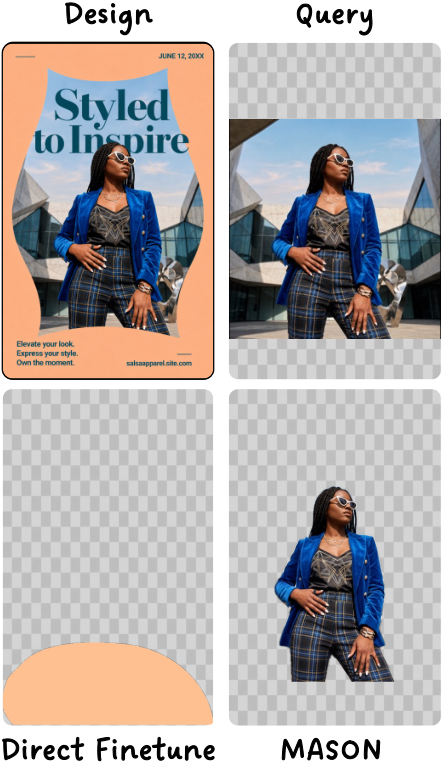
>
> Figure from [[Huang+ ECCV’26](https://arxiv.org/html/2608.26716v1#S5.F6.sf3)]:\
> Clipping の完成画像・質問対象と両モデルの対応先

> **切り抜き画像と元画像の関係を認識**
>
> - 質問対象: 切り抜く前の人物画像
> - DF: 元画像と幅が似た装飾へ誤対応
>   - 切り抜き画像と元画像の関係を捉えられず
> - MASON: 切り抜いた人物の前景を特定
>   - 元画像と合成関係にある要素を認識

---

<!-- _class: analysis-slide efficiency-slide qualitative-slide content-slide-gray classification-public -->
<!-- 発表目安 1:00 -->

## 定性結果 2/2 **|** _Morphing の成功例と残る制限_

> 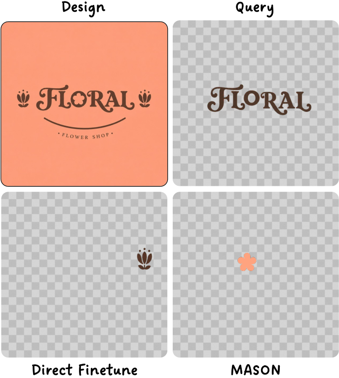
>
> Figure from [[Huang+ ECCV’26](https://arxiv.org/html/2608.26716v1#S5.F6.sf1)]:\
> Morphing の完成画像・質問対象と両モデルの対応先

> **文字を置き換える花を特定**
>
> - DF: 色・配置が似た別要素へ誤対応
> - MASON:「FLORAL」の「O」を置き換える花を特定
>
> **残る課題・著者らの将来方向**
>
> - Morphing: 全データでも **70.21%**
>   - 訓練データに占める割合は **2.63%**
>   - 大きな変形と意味の置き換えが必要
> - 将来方向: レイヤー構造を考慮する視覚エンコーダと、視覚・言語の対応付けの強化

---

<!-- _class: analysis-slide content-slide-gray classification-public -->
<!-- 発表目安 0:50 -->
<!-- 考察の根拠: https://arxiv.org/html/2608.26716v1 Sec. 4.2, Sec. 5.3–5.4, Tables 4–5, 7 -->

## 気になったところ **|** _本当に「画像から構造を理解する」能力が改善したのか？_

**発表者の考察**

> **推論時の入力と評価対象**
>
> - MASON は推論時にも画像・正確な要素メタデータ・前後／包含／重なりの関係を入力
> - 編集可能なデザインファイルを扱う支援システムでは自然な前提
> - レイヤーのない 1 枚の画像から、構造自体を復元する設定とは異なる
>
> **分離して検証したい能力**
>
> - 画像から構造を推定する能力
> - 与えられた構造を利用する能力

> **MA・SP の効果は合成関係の種類で異なる**
>
> - Clipping（Table 5）
>   - SP 単独 **83.33%** > MA+SP **81.82%**
> - Morphing（Table 5）
>   - DF **72.34%** → MA+SP **80.85%**
>   - 全データ条件では **70.21%**（Table 4）
>
> **追加で確認したい点**
>
> - 関係の種類に応じた学習の効果
>   - MA・SP の学習データと組み合わせを変更
> - 希少な関係への追加データの効果

---

<!-- _class: analysis-slide efficiency-slide content-slide-gray classification-public -->
<!-- 発表目安 0:20 -->
<!-- 主結果: https://arxiv.org/html/2608.26716v1#S5.T4 -->

## まとめ **|** _要素の「見た目」と「レイヤー間の関係」を同時に扱うことが重要_

> 
>
> Figure from [[Huang+ ECCV’26](https://arxiv.org/html/2608.26716v1#S0.F1.sf5)]: 関連レイヤーの一括編集

> - **課題**: 複数レイヤーが協調するデザインでは、独立要素の位置認識だけでは不十分
> - **CoDeLayout**: 約 20K 件のデザインで関連要素ペアとデザイン意図を評価
> - **MASON**: 見た目の対応付け（MA）とレイヤー間の関係（SP）で追加学習
> - **残る論点**: Morphing の難しさ・推論時に必要な正確なメタデータ

**Qwen2.5-VL 7B を主タスクの全データで学習した場合の比較**\
重み付き精度: DF **88.80%** → MASON **91.66%**（+2.86 pt）\
MASON は主タスク QA に加え、補助 QA と構造情報を利用

---

<!-- _class: title-slide-big classification-public debug-layout-->

# 表紙用の背景

`_class: title-slide-big classification-public`

---

<!-- _class: content-slide-gray classification-public layout-example -->

## 図や説明を置くページ

`_class: content-slide-gray classification-public`

---

<!-- _class: takahashi classification-public -->

# 伝えたいことを一つ
